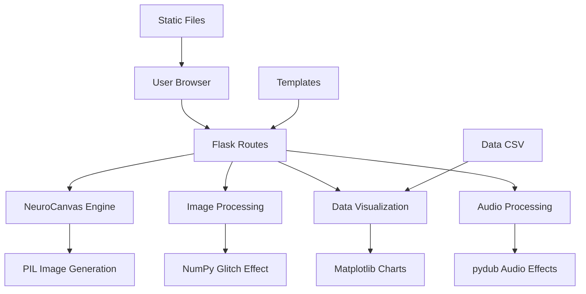

# NeuroCanvas – Interactive Generative Art Gallery

**Python | Flask | Generative Art | Data Visualization | Image Processing**

An interactive web application combining creative programming, image processing, and data visualization to explore the intersection of art and technology.

## Project Overview

NeuroCanvas is a Flask-based web application that provides a digital gallery where users can explore procedurally generated artworks, interact with a drawing canvas, visualize data, and manipulate uploaded images. The project demonstrates the integration of Python programming with modern web technologies to create an engaging creative computing experience.

## Engineering Objectives and Challenges

### Objectives
- Create a generative art engine using procedural generation techniques
- Implement real-time image processing with glitch effects
- Build interactive data visualization with Matplotlib
- Design a responsive web interface with Flask and Jinja2 templates
- Establish proper software engineering practices including testing, linting, and CI/CD

### Challenges Addressed
- **Python 3.13 Compatibility**: Adapted dependencies (NumPy 2.1.0, Pandas 2.2.3, Matplotlib 3.9.2) to work with Python 3.13, including handling the removal of the `audioop` module
- **Security**: Implemented file upload validation with MIME type checking, secure filename handling, and environment variable configuration
- **Code Quality**: Added type hints, comprehensive docstrings, automated testing with pytest, and code formatting with Black and Ruff
- **Maintainability**: Structured code with clear separation of concerns between routes, helper functions, and the generative art engine

## Implemented Features

### 1. Generative Art Engine
- **NeuroCanvas Class**: Object-oriented implementation for generating cyberpunk-style artworks
- **Procedural Generation**: Uses random algorithms to create unique neon-colored polygons with glow effects
- **Image Processing**: Applies smoothing filters for polished visual output
- **API Endpoint**: `/generate/cyberpunk` returns dynamically generated PNG images

### 2. Data Visualization
- **Matplotlib Integration**: Generates visual representations of weather datasets
- **Dynamic Charting**: Creates dark-themed line charts with area fills
- **Data Processing**: Uses Pandas for CSV data parsing and manipulation
- **Image Output**: Returns charts as PNG images via `/data-viz` endpoint

### 3. Image Lab
- **File Upload**: Secure image upload with validation (PNG, JPG, JPEG)
- **Glitch Effect**: Applies horizontal band shifting algorithm to create digital glitch aesthetics
- **Real-time Processing**: Uses NumPy array manipulation for fast image transformations
- **Preview**: Displays original and processed images side-by-side

### 4. Audio Lab
- **Audio Upload**: Supports MP3 and WAV file formats
- **Effects**: Implements reverse and speedup audio effects using pydub
- **Processing**: Requires FFmpeg for audio manipulation (documented limitation)
- **Playback**: Browser-based audio player for processed files

### 5. Interactive Art Canvas
- **HTML5 Canvas**: Client-side drawing interface
- **Generative Interaction**: Click-to-create random colored shapes
- **Export**: Save canvas as PNG image
- **JavaScript**: Vanilla JS implementation without external dependencies

## Technologies Used

| Category | Technologies |
|----------|--------------|
| **Backend** | Python 3.13, Flask 3.0.3 |
| **Data Processing** | NumPy 2.1.0, Pandas 2.2.3 |
| **Visualization** | Matplotlib 3.9.2 |
| **Image Processing** | Pillow 10.4.0 |
| **Audio Processing** | pydub 0.25.1, audioop-lts (Python 3.13) |
| **Frontend** | HTML5, CSS3, JavaScript (ES6+), Tailwind CSS 2.2.19 |
| **Testing** | pytest 9.2.0, pytest-cov 7.1.0 |
| **Code Quality** | Black 26.10.1, Ruff 0.17.3 |
| **CI/CD** | GitHub Actions |

## Architecture



## Repository Structure

```text
ProjetAi/
├── .github/
│   └── workflows/
│       └── ci.yml              # GitHub Actions CI configuration
├── app.py                      # Main Flask application
├── config.py                   # Application configuration (future use)
├── requirements.txt            # Production dependencies
├── requirements-dev.txt       # Development dependencies
├── .env.example               # Environment variable template
├── .gitignore                 # Git ignore patterns
├── .ruff.toml                 # Ruff linter configuration
├── pytest.ini                 # Pytest configuration
├── data/
│   └── weather_data.csv       # Sample weather dataset
├── static/
│   ├── css/
│   │   └── style.css          # Custom styles
│   ├── js/
│   │   ├── app.js             # Gallery interaction
│   │   ├── image-lab.js       # Image lab functionality
│   │   └── interactive-art.js # Canvas drawing
│   └── uploads/               # User-uploaded files (gitignored)
├── templates/
│   ├── base.html              # Base template with navigation
│   ├── index.html             # Homepage
│   ├── gallery.html           # Generative art gallery
│   ├── image-lab.html         # Image/audio processing interface
│   └── interactive-art.html  # Interactive canvas
├── tests/
│   ├── __init__.py
│   ├── test_app.py            # Flask route and functionality tests
│   └── test_neurocanvas.py    # Generative art engine tests
├── screenshots/
│   ├── homepage.png
│   ├── gallery.png
│   ├── interactive-canvas.png
│   ├── image-lab.png
│   └── data-visualization.png
├── demonstration.mp4          # Video demonstration
├── rapport.pdf                # Project report (French)
└── README.md                  # This file
```

## Installation

### Prerequisites
- Python 3.12 or 3.13
- pip (Python package manager)
- FFmpeg (optional, required for audio processing features)

### Windows

1. **Clone the repository**
   ```bash
   git clone https://github.com/hiba400/ProjetAi.git
   cd ProjetAi
   ```

2. **Create a virtual environment**
   ```bash
   python -m venv venv
   venv\Scripts\activate
   ```

3. **Install dependencies**
   ```bash
   pip install -r requirements.txt
   ```

4. **Set up environment variables** (optional for development)
   ```bash
   copy .env.example .env
   ```
   Edit `.env` and replace `your-secret-key-here-change-in-production` with a secure secret key. Generate one with:
   ```bash
   python -c "import secrets; print(secrets.token_hex(32))"
   ```

5. **Run the application**
   ```bash
   python app.py
   ```

   The application will start on `http://127.0.0.1:5000`

### Linux/macOS

1. **Clone the repository**
   ```bash
   git clone https://github.com/hiba400/ProjetAi.git
   cd ProjetAi
   ```

2. **Create a virtual environment**
   ```bash
   python3 -m venv venv
   source venv/bin/activate
   ```

3. **Install dependencies**
   ```bash
   pip install -r requirements.txt
   ```

4. **Set up environment variables** (optional for development)
   ```bash
   cp .env.example .env
   ```
   Edit `.env` with your preferred editor and update the secret key.

5. **Run the application**
   ```bash
   python app.py
   ```

   The application will start on `http://127.0.0.1:5000`

## Configuration

### Environment Variables

The application can be configured using environment variables. Copy `.env.example` to `.env` and customize:

| Variable | Description | Default |
|----------|-------------|---------|
| `FLASK_ENV` | Environment mode | `development` |
| `FLASK_DEBUG` | Enable debug mode | `False` |
| `SECRET_KEY` | Flask secret key for sessions | `dev-secret-key-change-in-production` |
| `MAX_CONTENT_LENGTH` | Maximum upload size in bytes | `16777216` (16 MB) |
| `UPLOAD_FOLDER` | Directory for uploaded files | `static/uploads` |

### FFmpeg Installation (Optional)

For audio processing features, FFmpeg must be installed:

**Windows:**
```bash
winget install ffmpeg
```

**Linux (Ubuntu/Debian):**
```bash
sudo apt update
sudo apt install ffmpeg
```

**macOS:**
```bash
brew install ffmpeg
```

## Application Screenshots

### Homepage


### Generative Art Gallery


### Interactive Art Canvas


### Image Lab


### Data Visualization


## Demonstration

A video demonstration of the application is available in the repository.

[View Demonstration](demonstration.mp4)

## Project Report

A technical report describing the application and its development is available (in French).

[View Project Report](rapport.pdf)

## Testing

### Running Tests

Install development dependencies:
```bash
pip install -r requirements-dev.txt
```

Run the test suite:
```bash
pytest tests/ -v
```

Run tests with coverage:
```bash
pytest tests/ --cov=app --cov-report=html
```

### Test Coverage

The project includes comprehensive tests for:
- Generative art engine functionality
- Flask route endpoints
- File upload validation
- Image processing
- Error handling

Current test suite: **20 tests** covering core functionality.

## Code Quality

### Linting and Formatting

The project uses **Ruff** for linting and **Black** for code formatting.

Check code with Ruff:
```bash
ruff check .
```

Auto-fix issues:
```bash
ruff check . --fix
```

Format code with Black:
```bash
black .
```

Check formatting without changes:
```bash
black --check .
```

## Troubleshooting

### Python 3.13 Audio Processing Issue

**Problem:** `ModuleNotFoundError: No module named 'audioop'`

**Solution:** The `audioop` module was removed in Python 3.13. The project uses `audioop-lts` as a compatible replacement. Ensure `requirements.txt` includes:
```
audioop-lts; python_version>='3.13'
```

### FFmpeg Not Found Warning

**Problem:** RuntimeWarning about missing FFmpeg

**Solution:** This warning appears when FFmpeg is not installed. Audio processing features will be limited. Install FFmpeg following the instructions in the Configuration section above, or ignore the warning if audio features are not needed.

### Port Already in Use

**Problem:** `Address already in use` error when starting the application

**Solution:** Either stop the process using port 5000 or specify a different port:
```bash
python app.py
# Edit app.py and change the last line to:
# app.run(debug=False, port=5001)
```

### Matplotlib Deprecation Warnings

**Problem:** PyparsingDeprecationWarning from matplotlib

**Solution:** These are warnings from matplotlib's internal dependencies and do not affect functionality. They will be resolved in future matplotlib updates.

## Security Considerations

- **File Upload Validation**: Files are validated by both extension and MIME type
- **Secure Filenames**: Uses `werkzeug.utils.secure_filename` to prevent directory traversal
- **Size Limits**: Maximum upload size limited to 16 MB by default
- **Environment Variables**: Sensitive configuration loaded from environment, not hardcoded
- **Debug Mode**: Disabled by default in production configuration
- **No Secrets Tracked**: `.env` and virtual environments are excluded from Git

## Limitations

1. **Audio Processing**: Requires FFmpeg installation; not portable without it
2. **Data Visualization**: Currently supports only the included weather dataset
3. **No Database**: Artworks are generated on-demand and not persisted
4. **No Authentication**: Application is public without user accounts
5. **Static Data**: Data visualization uses a fixed CSV file

## Future Enhancements (NOT IMPLEMENTED)

The following features are planned but not currently implemented:

- [ ] Database integration for artwork persistence
- [ ] User authentication and personalized galleries
- [ ] Multiple generative art styles beyond cyberpunk
- [ ] Machine learning-based style transfer
- [ ] Real-time collaborative canvas
- [ ] Expanded dataset support for data visualization
- [ ] API for programmatic artwork generation
- [ ] Docker containerization for deployment

## Author

**Hiba Ben Adou**

Computer Engineering Student – ENSA Tangier

Interested in Artificial Intelligence, Machine Learning, Software Engineering, and Data-Driven Applications.

## Project Context

Academic project developed to explore creative computing, web development, and Python-based data processing. This project serves as a demonstration of software engineering practices suitable for a professional portfolio.

## License

No license has been selected for this project. All rights reserved to the author.

---

**Note:** This project does not implement neural networks, deep learning, AI agents, or predictive machine learning. The term "NeuroCanvas" refers to the aesthetic theme of the generative art, not to neural network technology.
